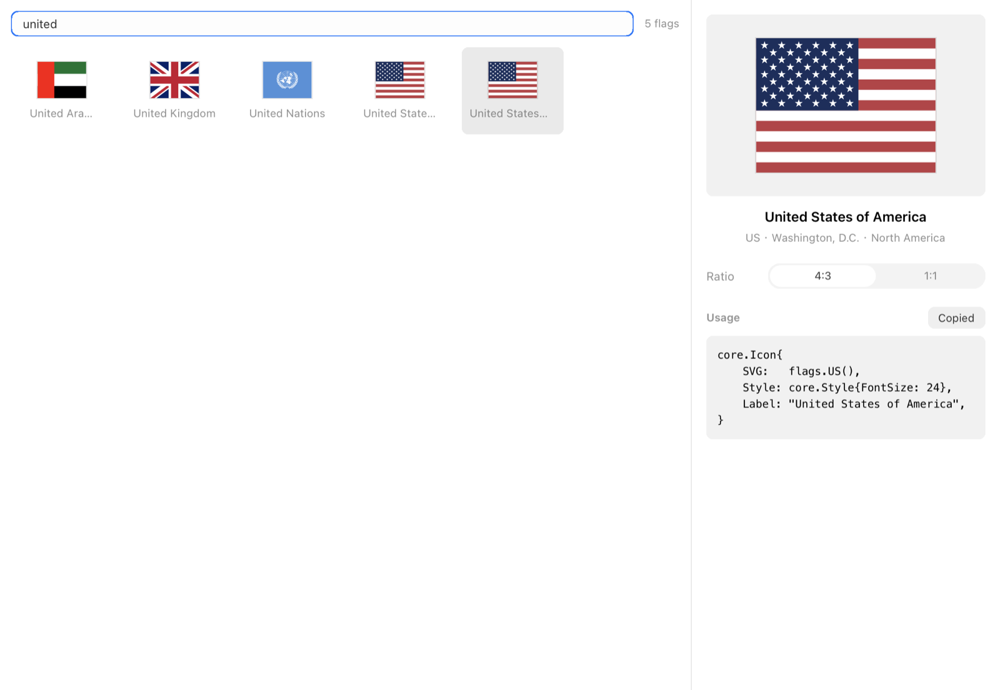

<h1 align="center">NSGo Flag Icons</h1>

<p align="center">
  <strong>English</strong> |
  <a href="README.zh-CN.md">简体中文</a>
</p>

<p align="center">
  271 country flags from <a href="https://github.com/lipis/flag-icons">flag-icons</a> for <a href="https://github.com/nsgo-dev/nsgo">NSGo</a> apps, in 4:3 and 1:1, drawn natively from SVG on every platform NSGo runs on.
</p>

<p align="center">
  
</p>

## Install

```sh
go get github.com/nsgo-dev/nsgo-icons-flags
```

Requires Go 1.26. `go get` brings the NSGo commit this library is built against.

## Usage

```go
import flags "github.com/nsgo-dev/nsgo-icons-flags"

core.Icon{SVG: flags.JP(), Style: core.Style{FontSize: 24}, Label: "Japan"}
core.Icon{SVG: flags.GBSct(), Style: core.Style{FontSize: 24}, Label: "Scotland"}
ui.IconButton{Icon: flags.EUSquare, Label: "Europe"}
```

Each flag has two accessors named after its upstream code: `JP` for the 4:3 flag and `JPSquare` for the 1:1 one. The first part of the code is in capitals and the rest capitalized, so `gb-sct` is `GBSct`. Without a size, `core.Icon` is as high as the inherited font size and as wide as the ratio makes it. A binary carries only the flags it calls.

When the code is known only at run time, such as the region of the user's locale, use the catalog:

```go
import "github.com/nsgo-dev/nsgo-icons-flags/catalog"

if f, ok := catalog.Find("GB"); ok {
	core.Icon{SVG: f.SVG(), Style: core.Style{FontSize: 24}, Label: f.Name}
}
```

`Find` ignores case, `All` lists every flag by English name, and each `Flag` has its code, name, capital, continent and whether the code is ISO 3166-1. Importing the catalog links every flag into the binary, about 4 MB.

To find a flag and copy the code that draws it, run the gallery:

```sh
go tool nsgo dev examples/gallery
```

## Development

From the repository root:

```sh
go vet ./...
go test ./...
go tool nsgo test -target macos examples/gallery
```

Regenerate the flags from a clean flag-icons checkout at a commit:

```sh
go run ./tools/flaggen -upstream /path/to/flag-icons -commit <40-character-commit>
```

See [ARCHITECTURE.md](ARCHITECTURE.md) for how the flags are generated and [CHANGELOG.md](CHANGELOG.md) for what changed.

## License

The code is licensed under the [MIT License](LICENSE).

The flags are from [flag-icons](https://github.com/lipis/flag-icons), Copyright (c) 2013 Panayiotis Lipiridis, under the MIT License in [LICENSE-FLAGS](LICENSE-FLAGS).
