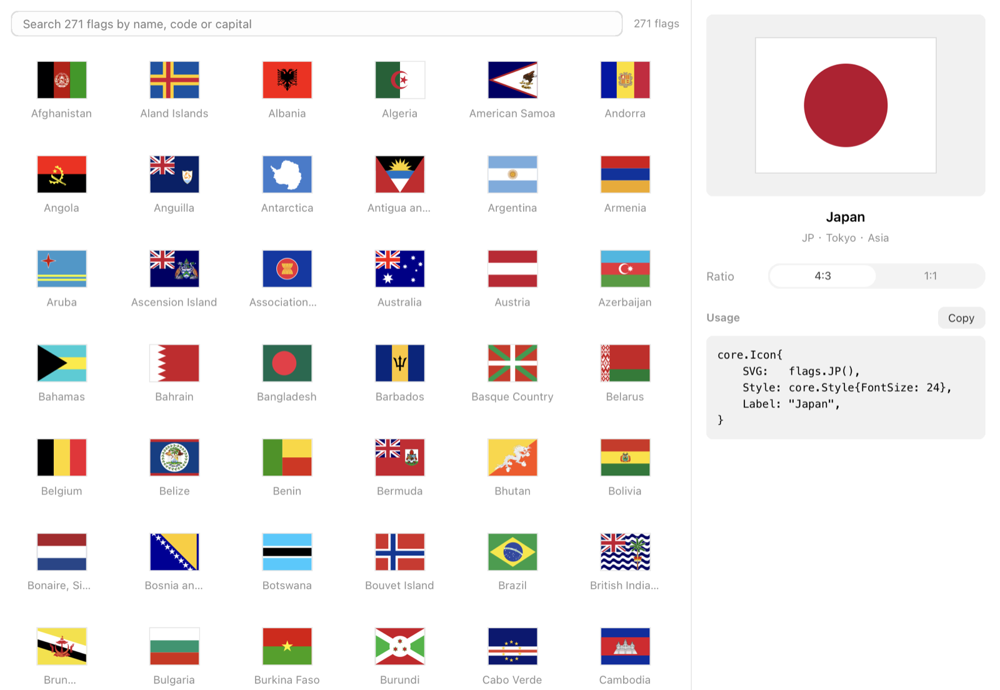

<h1 align="center">NSGo Flag Icons</h1>

<p align="center">
  <a href="README.md">English</a> |
  <strong>简体中文</strong> |
  <a href="https://nsgo-dev.github.io/nsgo-icons-flags/zh/">网站</a>
</p>

<p align="center">
  把 <a href="https://github.com/lipis/flag-icons">flag-icons</a> 的 271 面国旗带到 <a href="https://github.com/nsgo-dev/nsgo">NSGo</a> 应用里，有 4:3 和 1:1 两种比例，在 NSGo 支持的每个平台上都由 SVG 原生绘制。
</p>

<p align="center">
  
</p>

## 安装

```sh
go get github.com/nsgo-dev/nsgo-icons-flags
```

需要 Go 1.26。`go get` 会一并拉取本库所基于的 NSGo 提交。

## 用法

```go
import flags "github.com/nsgo-dev/nsgo-icons-flags"

core.Icon{SVG: flags.JP(), Style: core.Style{FontSize: 24}, Label: "Japan"}
core.Icon{SVG: flags.GBSct(), Style: core.Style{FontSize: 24}, Label: "Scotland"}
ui.IconButton{Icon: flags.EUSquare, Label: "Europe"}
```

每面国旗有两个以上游代码命名的访问函数：`JP` 是 4:3 的国旗，`JPSquare` 是 1:1 的。代码第一段全大写，其余各段首字母大写，所以 `gb-sct` 是 `GBSct`。不指定尺寸时，`core.Icon` 的高度等于继承的字号，宽度按比例算出。二进制里只包含实际调用到的国旗。

代码要到运行时才知道时（比如用户语言区域里的地区），用 catalog：

```go
import "github.com/nsgo-dev/nsgo-icons-flags/catalog"

if f, ok := catalog.Find("GB"); ok {
	core.Icon{SVG: f.SVG(), Style: core.Style{FontSize: 24}, Label: f.Name}
}
```

`Find` 不区分大小写，`All` 按英文名列出所有国旗，每个 `Flag` 带有代码、名称、首都、所在大洲，以及代码是否属于 ISO 3166-1。引入 catalog 会把所有国旗链接进二进制，约 4 MB。

要查找国旗并复制绘制它的代码，运行 gallery：

```sh
go tool nsgo dev examples/gallery
```

## 开发

在仓库根目录：

```sh
go vet ./...
go test ./...
go tool nsgo test -target macos examples/gallery
```

从某个提交的干净 flag-icons 检出重新生成国旗：

```sh
go run ./tools/flaggen -upstream /path/to/flag-icons -commit <40 位提交哈希>
```

生成方式见 [ARCHITECTURE.md](ARCHITECTURE.md)，变更记录见 [CHANGELOG.md](CHANGELOG.md)。

## 许可证

代码采用 [MIT 许可证](LICENSE)。

国旗来自 [flag-icons](https://github.com/lipis/flag-icons)，Copyright (c) 2013 Panayiotis Lipiridis，采用 [LICENSE-FLAGS](LICENSE-FLAGS) 中的 MIT 许可证。
